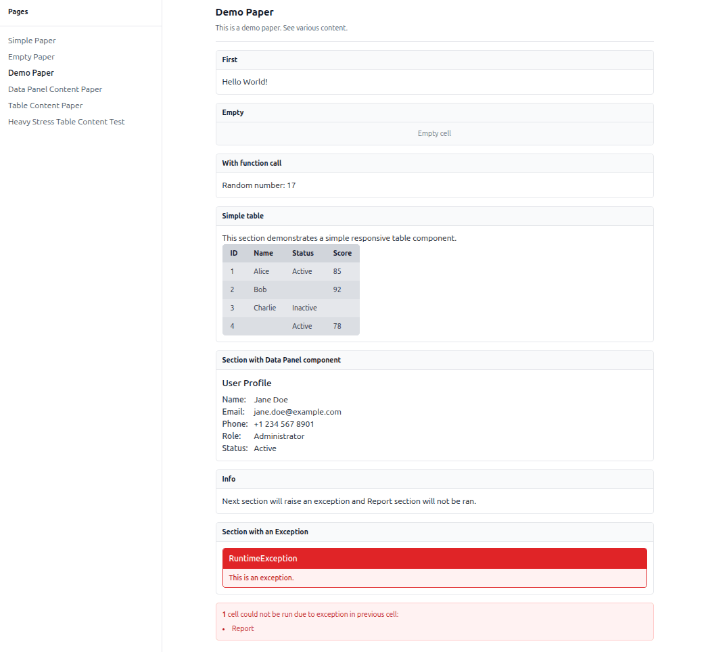

# Laravel Papers

> ⚠️ **Experimental Package — Use With Caution**
>
> Laravel Papers is still in **early development** and considered experimental. While it is functional and may be used in production environments, please be aware of the following:
>
> - The API is **not stable** and may change significantly in upcoming releases.
> - Documentation may be incomplete or subject to improvement.
> - Backward compatibility between minor versions is **not guaranteed**.
> - Use at your own risk — review the source code and test thoroughly before deploying in critical systems.
>
> Feedback, issues, and contributions are very welcome as the package evolves. If you're using it in production, consider locking to a specific version.

[](https://packagist.org/packages/schrojf/laravel-papers)
[](https://github.com/schrojf/laravel-papers/actions?query=workflow%3Arun-tests+branch%3Amain)
[](https://github.com/schrojf/laravel-papers/actions?query=workflow%3A"Fix+PHP+code+style+issues"+branch%3Amain)
[](https://packagist.org/packages/schrojf/laravel-papers)

**Laravel Papers** is a lightweight and flexible package for building and displaying custom debug or reporting pages — called *Papers* — within your Laravel application. Each Paper can aggregate and display structured or unstructured data from various sources such as databases, services, or internal logic.

Originally created as an experimental project, **Laravel Papers** is ideal for internal tools, dashboards, and developer-oriented views that are simple to register and use.



## Features

- Create dynamic reporting pages using reusable components
- Render structured data using tables and data panels
- Handle forms and buttons with CSRF protected actions
- Build forms, buttons and links to paper pages and actions without writing their URLs
- Find papers quickly with a keyboard friendly filter
- Secure access using Laravel's Gate authorization

## Requirements

- Laravel Framework 12.x or 13.x
- PHP version 8.2, 8.3, 8.4 or 8.5 (Laravel 13 requires PHP 8.3 or later)
- Modern web browser: Safari 16.4, Chrome 111, Firefox 128 or later

## Installation

Install the package via Composer:

```bash
composer require schrojf/laravel-papers
```

Publish the configuration file (optional):

```bash
php artisan vendor:publish --tag="papers-config"
```

This is the default `config/papers.php` file:

```php
return [

    'middleware' => [
        'web',
        \Schrojf\Papers\Http\Middleware\AuthorizePapers::class,
    ],

    'api_middleware' => [
        'api',
        \Schrojf\Papers\Http\Middleware\AuthorizePapers::class,
    ],

];
```

Publish the views (optional):

```bash
php artisan vendor:publish --tag="papers-views"
```

Publish the assets (optional), so they are served as cacheable files instead of being inlined in every page:

```bash
php artisan vendor:publish --tag="papers-assets"
```

The assets are also published with the `laravel-assets` tag, so the `post-update-cmd` script of a default Laravel application keeps them up-to-date. Outdated published assets are ignored in favour of the inlined assets.

When your application sets a Content Security Policy nonce with `Vite::useCspNonce()`, the inlined style and script tags of papers pages use it too.

## Usage

### Registering Papers

Define and register your Paper classes in a service provider, such as `AppServiceProvider.php`:

```php
use Schrojf\Papers\Papers;
use App\Papers\MyReportPaper;

public function boot(): void
{
    Papers::register([
        MyReportPaper::class,
    ]);
}
```

### Finding Papers

The navigation and the index page have a filter for finding papers by their name, description or URL handler. Press `/` to focus it, the arrow keys and `Enter` to open a paper, and `Escape` to clear it. The filter ignores letter case and diacritics, so `stitky` finds "Štítky", and it keeps the query while you browse papers in the same browser tab.

Add keywords to find a paper by other words too, such as synonyms or translations of its name:

```php
class SalesByBrand extends Paper
{
    public static $keywords = ['revenue', 'tržby'];
}
```

### Access Control

By default, access to Papers is restricted in non-local environments. Define a Gate to control who can view them:

```php
use Illuminate\Support\Facades\Gate;
use App\Models\User;

public function boot(): void
{
    Gate::define('viewPapers', function (User $user) {
        return in_array($user->email, [
            'admin@example.com',
        ]);
    });
}
```

### Favicon and Head

Papers pages use your app's `/favicon.ico` by default. Set a favicon of their own, so their browser tabs stand out from the rest of your app:

```php
use Schrojf\Papers\Papers;

public function boot(): void
{
    Papers::favicon(asset('favicon-green.png'));
}
```

Add any other HTML to the head of papers pages, such as more icons, a web manifest or a theme color. It is not escaped, and a closure is called whenever a page is rendered:

```php
Papers::head(fn () => view('papers.head'));
```

```blade
{{-- resources/views/papers/head.blade.php --}}
<link rel="icon" href="{{ asset('favicon-green.ico') }}" sizes="16x16 32x32 48x48">
<link rel="apple-touch-icon" href="{{ asset('apple-touch-icon-green.png') }}">
<link rel="manifest" href="{{ asset('papers.webmanifest') }}">
```

## Creating a Paper

A Paper class extends `Schrojf\Papers\Paper` and defines its sections as callable functions. Each section returns content such as strings, arrays, or component instances like `TableContent` or `DataPanelContent`.

Here’s a full example:

```php
<?php

namespace App\Papers;

use RuntimeException;
use Schrojf\Papers\Contents\DataPanelContent;
use Schrojf\Papers\Contents\TableContent;
use Schrojf\Papers\Paper;

class DemoPaper extends Paper
{
    public static $description = 'This is a demo paper showing various content types.';
    
    public function sections(): array
    {
        return [
        
            'Simple Text' => fn () => ['Hello', 'World!'],

            'Empty' => function () {
                return null;
            },

            'With function call' => function () {
                $rand = rand(1, 100);

                return 'Random number: ' . $rand;
            },

            'Table Example' => fn () => [
                'This section demonstrates a responsive table.',
                TableContent::withHeaders(['ID', 'Name', 'Status', 'Score'])
                    ->row([1, 'Alice', 'Active', 85])
                    ->row([2, 'Bob', null, 92])
                    ->row([3, 'Charlie', 'Inactive', null])
                    ->row([4, null, 'Active', 78]),
            ],

            'Section with Data Panel Component' => function () {
                return DataPanelContent::make()
                    ->title('User Profile')
                    ->item('Name', 'Jane Doe')
                    ->item('Email', 'jane.doe@example.com')
                    ->item('Phone', '+1 234 567 8901')
                    ->item('Role', 'Administrator')
                    ->item('Status', 'Active');
            },

            'Info' => function () {
                return 'Next section will raise an exception and the Report section will not be run.';
            },

            'Exception Demo' => function () {
                throw new RuntimeException('This is a simulated error.');
            },

            'Unreachable Section' => fn () => 'This will not be rendered if the previous section fails.',
            
        ];
    }
}
```

### Full Width

Paper pages are limited in width to keep text readable. Papers with wide content, such as tables with many columns, may use the full width of the screen:

```php
class SalesReport extends Paper
{
    public static $fullWidth = true;
}
```

### Fitting Tables

Tables keep each cell on a single line and scroll horizontally when they are wider than their section. Call `fit()` to fit a table to the width of its section instead. The table then spans the whole section, and its columns shrink by wrapping their content: headers wrap between words only, while values may break anywhere, so long URLs or references don't widen the table. It scrolls only when its content can't shrink any further, e.g. a wide image, or headers which don't fit a narrow screen.

```php
TableContent::withHeaders(['ID', 'Product', 'URL'])
    ->rows($rows)
    ->fit();
```

### Named Pages

A paper may have more pages than its main one, such as `/papers/orders/done` or `/papers/orders/history`. Add an optional parameter to `sections()`, which gets the page name from the URL, and return the sections of that page:

```php
class Orders extends Paper
{
    public function sections(?string $page = null): array
    {
        return match ($page) {
            null => ['Orders' => fn () => $this->ordersTable()],
            'history' => ['History' => fn () => $this->historyTable()],
            default => abort(404),
        };
    }
}
```

Papers whose `sections()` has no parameter have no named pages, so their URLs with a page name are not found.

## Actions

Sections are built for every `GET` request of the paper page, so they must never change any data. A GET request is not protected against CSRF — a link or an image on any other website opened by a signed-in user could make it.

To change data, define an optional `action()` method on the paper and submit a form from a section to the paper's action URL with the `POST` method. The `POST` request runs in the `web` middleware group, so it requires a CSRF token. Papers without an `action()` method answer it with `405 Method Not Allowed`.

Dependencies of the `action()` method are resolved from the container, so you may type-hint any service or your own form request. What the method returns decides what the browser gets:

- **Nothing** — the paper page is rendered right away by the same paper instance, so sections can show what the action stored on it.
- **A response** — a redirect, a download, JSON or anything else Laravel can send is returned as it is.

```php
<?php

namespace App\Papers;

use App\Models\Product;
use Illuminate\Http\Request;
use Schrojf\Papers\Contents\FormContent;
use Schrojf\Papers\Paper;

class ProductPrices extends Paper
{
    protected ?int $updated = null;

    public function sections(): array
    {
        $sections = [
            'Form' => fn () => FormContent::make(static::actionUrl())
                ->number('discount', 'Discount (%)', attributes: ['min' => 1, 'max' => 90])
                ->submit('Apply discount', 'intent', 'discount')
                ->submit('Export prices', 'intent', 'export', 'secondary'),
        ];

        if (! is_null($this->updated)) {
            $sections['Result'] = fn () => "Prices of {$this->updated} products were updated.";
        }

        return $sections;
    }

    public function action(Request $request): mixed
    {
        if ($request->input('intent') === 'export') {
            return response()->streamDownload(function () {
                echo Product::query()->pluck('price', 'id')->toJson();
            }, 'prices.json');
        }

        $validated = $request->validate([
            'discount' => ['required', 'integer', 'between:1,90'],
        ]);

        $products = Product::all();

        foreach ($products as $product) {
            $product->update([
                'price' => round($product->price * (100 - $validated['discount']) / 100, 2),
            ]);
        }

        $this->updated = $products->count();

        return null;
    }
}
```

When the action fails validation, the browser is redirected back with the errors and the old input in the session, as anywhere else in Laravel. Forms made by `FormContent` show them by their fields.

### Named Actions

A paper may have several actions, each with a URL of its own, such as `/papers/orders/cancel` or `/papers/orders/refund`. The action name from the URL is passed to the `action()` method. Like route parameters of controllers, it goes to the first parameter which isn't a dependency, whatever its name:

```php
public function action(Request $request, string $action): mixed
{
    return match ($action) {
        'cancel' => $this->cancel($request),
        'refund' => $this->refund($request),
        default => abort(404),
    };
}
```

Make the parameter optional, e.g. `?string $action = null`, to handle the paper's action URL without a name too. Papers whose `action()` has no such parameter have no named actions, so their URLs with an action name are not found.

### Result Page

Refreshing a page rendered right after the action submits the form again, which would e.g. apply the discount twice. Return a redirect to load a page by a `GET` request instead, and pass the result of the action through the session. Refreshing the page then only loads it again:

```php
public function action(Request $request, string $action): mixed
{
    // ...

    return static::redirect('done')->with('result', "The order #{$order->id} was refunded.");
}

public function sections(?string $page = null): array
{
    if ($page === 'done') {
        return [
            'Result' => fn () => session()->has('result')
                ? AlertContent::success(session('result'))
                : AlertContent::info('The result of an action is shown only once.'),
            'Next' => fn () => LinkContent::make('Back to orders', static::url())->button('primary'),
        ];
    }

    // ...
}
```

### Calling Actions from Scripts

Scripts in sections can call the action in the background too, e.g. for an action returning JSON. The paper page provides the token in its `csrf-token` meta tag:

```js
fetch('/papers/product-prices/email', {
    method: 'POST',
    headers: {
        'Accept': 'application/json',
        'Content-Type': 'application/json',
        'X-CSRF-TOKEN': document.querySelector('meta[name="csrf-token"]').content,
    },
    body: JSON.stringify({ to: 'sales@example.com' }),
});
```

## Forms, Buttons and Links

### URLs

Papers make the URLs of their pages and actions, so you never write them by hand. They are static methods, so a paper may link to other papers too, e.g. `Orders::url('history')`:

| Method                                         | URL                                  |
|------------------------------------------------|--------------------------------------|
| `static::url()`                                | `/papers/orders`                     |
| `static::url('history')`                       | `/papers/orders/history`             |
| `static::url(query: ['status' => 'open'])`     | `/papers/orders?status=open`         |
| `static::actionUrl()`                          | `/papers/orders` (POST)              |
| `static::actionUrl('refund')`                  | `/papers/orders/refund` (POST)       |
| `static::redirect('done')`                     | a redirect to `/papers/orders/done`  |

### Forms

`FormContent` makes a form with a CSRF token. After a failed validation, its fields show the old input and the errors of the request:

```php
FormContent::make(static::actionUrl('create'))
    ->text('title', 'Title', attributes: ['placeholder' => 'Water the plants', 'required' => true])
    ->number('estimate', 'Estimate (hours)', 1, ['min' => 1])
    ->input('due', 'Due date', 'date')
    ->textarea('notes', 'Notes')
    ->select('priority', 'Priority', ['low' => 'Low', 'high' => 'High'], 'low')
    ->checkbox('urgent', 'Urgent')
    ->hidden('project', $project->id)
    ->submit('Add task')
    ->submit('Add and open', 'then', 'open', 'secondary');
```

The value of a field is its default, used until the form is submitted. Extra attributes are added to the field as they are: `true` adds a boolean attribute, `false` or `null` leaves it out. Buttons are `primary`, `secondary` or `danger`, and a name and a value tell the action which button submitted the form. Call `confirm('Are you sure?')` to ask the user before the form is submitted.

### Buttons

`ButtonContent` is a button submitting an action on its own, such as in a table row. It has a CSRF token, and may send hidden values or ask to confirm the action first:

```php
TableContent::withHeaders(['Order', 'Total', ''])
    ->rows($orders->map(fn (Order $order) => [
        $order->number,
        $order->total,
        ButtonContent::make('Cancel', static::actionUrl('cancel'))
            ->hidden('order', $order->id)
            ->danger()
            ->confirm("Cancel the order {$order->number}?"),
    ])->all());
```

### Links

Sections show links styled as links, or as buttons, e.g. for the next step after an action:

```php
LinkContent::make('History', static::url('history'));

LinkContent::make('Back to orders', static::url())->button('primary');
```

### Alerts

`AlertContent` highlights a message, such as the result of an action. Alerts are `success`, `error`, `warning` or `info`, and may have a title:

```php
AlertContent::success('The order was refunded.')->title('Done');

AlertContent::error('The order was paid by a voucher, so it can\'t be refunded.');
```

## Testing

Run the test suite using:

```bash
composer test
```

## Changelog

See [CHANGELOG.md](CHANGELOG.md) for a list of recent changes.

## Contributing

Contributions are welcome! Please see [CONTRIBUTING.md](CONTRIBUTING.md) for guidelines.

## Security Vulnerabilities

If you discover a security vulnerability, please review [our security policy](SECURITY.md) for how to responsibly report it.

## Credits

- [Viliam Schrojf](https://github.com/schrojf)
- [All Contributors](../../contributors)

## License

This package is open-sourced software licensed under the [MIT license](LICENSE.md).
